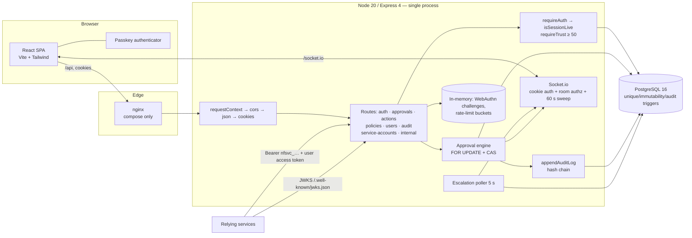

# NovaForge — Project Status, Security Audit & Roadmap

| | |
|---|---|
| **Audit date** | 2026-10-20 |
| **Audited commit** | `5f3a2a6cd999286c032dce44a921132fe6d15e9f` (`main`, 59 commits) |
| **Working tree at audit start** | One pre-existing modification: `server/prisma/migrations/migration_lock.toml` (line-ending-only; `git diff HEAD` has no content change). Left untouched. |
| **Method** | Source read of all server routes/libs/migrations/tests and the client core; Git history inspection; executed checks (Section 5). No application code, schema, migration or dependency manifest was modified. |
| **Evidence convention** | **Verified** = observed in code at HEAD and/or exercised by a command I ran. **Code-read** = confirmed by reading the code, not exercised. **Hypothesis** = plausible, needs a test. Claims in code comments or the README are *not* treated as evidence. |

> **Repository identity note.** The task names `github.com/DevOps-Tally/NovaForge`. This checkout's `origin` is `https://github.com/AryanRajguru22/NovaForge.git` and is in sync with it (`main...origin/main` = 0/0, `git ls-remote` returns `5f3a2a6`). `git ls-remote` against `DevOps-Tally/NovaForge` returns `main` = **`ca576c6`** — i.e. **the four security commits (`0401bba`, `406deb2`, `223830d`, `5f3a2a6`) are not in the org repository**; they exist only in the personal repository. This matters for hackathon submission and for Section 11.

---

## Section 1 — Executive Summary

**What NovaForge is.** A passwordless-first identity and governance service: WebAuthn passkeys (TOTP and recovery codes as throttled fallbacks), database-backed sessions with a decaying trust score, and an approval engine in which sensitive actions need N-of-M / weighted / role-based quorum from approvers who each sign their decision with a passkey. Every state change is written to a hash-chained, trigger-protected audit log. It also exposes a small service-to-service API that issues short-lived ES256 identity assertions to relying services. Stack: Express + Prisma + PostgreSQL (server), React + Vite + Tailwind (client), Socket.io for live updates, Docker/Render for deployment.

**Maturity.** The server is substantially more rigorous than a typical hackathon project: security-critical invariants are enforced in the database (unique vote constraint, audit triggers, immutable action subject), concurrency is handled with row locks and compare-and-swap writes, and there is a real-Postgres test suite. **All 240 tests pass against a clean PostgreSQL 16** (Section 5). The weak points are not the core engine; they are (a) the *governance plane around it* (policy/role edits are not themselves governed), (b) operational readiness (no CI, config validation, bootstrap path, monitoring, backups), and (c) a few claims that outrun the evidence (e.g. "non-repudiable votes", "nobody can quietly edit").

**Readiness verdict**

| Target | Verdict | Why |
|---|---|---|
| Local demo | **Ready** | Suite is green; build is green. Requires a local Postgres + `.env`. |
| Public demo (Render) | **Conditional** | A *fresh* deployment cannot create its first user: open registration is off by default and the bootstrap script is not in the production image (F-04). Identity-assertion endpoints return 503 until signing keys are configured. |
| Staging | **Not yet** | No CI, no secret/config validation, single-instance assumptions, no monitoring. |
| Production | **No** | Unresolved High findings F-01–F-05, no operational foundation (Section 7). |

---

## Section 2 — Verified Architecture

| Layer | What is actually there (verified in code) |
|---|---|
| **Frontend** | 6 pages (`Login`, `ApprovalDashboard` 1,206 lines, `PolicyManagement`, `AuditLog`, `UserManagement`, `Settings`), `lib/api.ts` (401→refresh→retry, single in-flight refresh), `lib/auth.tsx`, route guards. Silent refresh every 4 min (`App.tsx`). Socket.io client with `withCredentials`. No client tests, no lint config. |
| **Backend** | Express 4 + `express-async-errors`, zod validation on every body, generic 500 handler (`app.ts`). Routers mounted under `/api` (and bare when no client build is co-served). `/health` returns a static `{status:"ok"}` — it does **not** touch the database. |
| **Database** | Prisma 5 schema, 9 migrations applied cleanly to an empty PG16; `prisma migrate diff` schema↔migrations: **no drift**. Hand-written SQL (migration `20260914120000`) adds audit-chain triggers, `ApprovalVote` update-immutability, `SensitiveAction` subject immutability. |
| **Authentication** | WebAuthn via `@simplewebauthn/server` v10 (`attestationType:"none"`, UV required at registration/step-up). TOTP (`otplib`, AES-256-GCM at rest, ±5 s tolerance, monotonic `totpLastUsedStep` replay guard). Recovery codes: 10 × 80-bit, scrypt-hashed, single-use via conditional delete. Persistent per-email throttle (`AuthThrottle`, 5 attempts → exponential lock 15 min…24 h, row-locked). |
| **Sessions** | `Session` row = refresh-token family. Access JWT 15 min, refresh JWT 30 d, HS256 with separate secrets, pinned `iss`/`aud`/`alg`/`type`. Every request calls `isSessionLive` (row exists, not expired, user `ACTIVE`, `sub` matches). Trust decays 5/h, +5 per refresh check-in; sensitive writes require ≥ 50 (`requireTrust`). |
| **Authorization** | Roles `SUPER_ADMIN > ADMIN > SENIOR_APPROVER > APPROVER > MEMBER`, always re-read from the DB (never from token claims). Guards: `requireAdmin` (policies), `requireSuperAdmin` (users, audit, service accounts — three separate copies of the function). |
| **Approval engine** | `POST /actions` (trust-gated) creates action+request atomically with a canonical-JSON `payloadDigest`. `POST /approvals/:id/options` builds a canonical *decision statement*; WebAuthn challenge = SHA-256(statement). `POST /approvals/:id/vote` verifies the assertion against that challenge, then in one transaction: `SELECT … FOR UPDATE` on the request, re-derive digest, re-read policy, re-check eligibility, insert vote with evidence, recompute status, CAS `PENDING→terminal`, audit. |
| **Audit** | `AuditLog` with global `seq`, `AuditChainHead` singleton, BEFORE/AFTER INSERT triggers enforce `seq = head+1` / `prevHash = head.hash`; UPDATE/DELETE/TRUNCATE rejected. v2 hash covers seq, id, timestamp, entity, event, actorIdAtWrite, correlationId, metadata, prevHash. `verifyAuditChain` (repeatable-read snapshot) + optional external anchor. Every audited write uses `auditedTransaction`, so state change and audit row commit atomically. |
| **Real-time** | `io.use` authenticates the cookie JWT + live session. `join-challenge` validates a UUID, re-reads request/policy/user, authorizes via `canViewApprovalRecord`, then `socket.join`. 60 s sweep disconnects sockets whose session died; `users.ts` also disconnects immediately on disable/delete. |
| **Service identity** | `ServiceAccount`/`ServiceCredential` (`nfsvc_<id>.<secret>`, SHA-256 stored), scopes `identity:assert` / `identity:introspect`, ES256 assertions (5 min), JWKS endpoint. |
| **Deployment** | `docker-compose.yml` (PG16 + server + nginx client), `server/Dockerfile`, `client/Dockerfile`, `Dockerfile.render` (combined image, manually pushed to Docker Hub), `render.yaml` (reference only, not auto-synced). Container CMD runs `prisma migrate deploy` then the server. **No `.github/` — no CI/CD.** |

---

## Section 3 — Completed Work

Test counts are from my executed run (Section 5). "Present in HEAD" is verified; hash-era caveat: `5f3a2a6` later modified several files first touched by the three Aug-30 commits, so HEAD is not byte-identical to those commits.

### 3.1 The four milestones you asked me to verify

> **Numbering collision (important).** Your P0-1…P0-4 and the repository's own P0 labels are different schemes. Code comments/tests in `5f3a2a6` use: `p0-1` = enrollment tokens, `p0-2` = fallback-factor abuse (and the "P0-2: vote vs. expiry race" test title), `p0-3` = action access, `p0-4` = **decision binding** (comment in `approvals.ts`), P0-5 = atomic audit, `p0-6` = identity trust — while `jwt.ts`/`schema.prisma` also call **refresh rotation** "P0-4". Don't cite "P0-n" in a README/resume without qualifying which scheme.

| Your label | Repo evidence | Status |
|---|---|---|
| **P0-1 duplicate-vote prevention** (`0401bba`) | `schema.prisma`: `@@unique([requestId, approverId])`; migration `20260830120000_add_approval_vote_unique_constraint` (`CREATE UNIQUE INDEX`); `approvals.ts:39-43` (`isDuplicateVoteError`, P2002 + SQLSTATE 23505) and `:535-541` (→ friendly 400); `approvals.test.ts` has two real-concurrency tests ("database allows only one of two genuinely concurrent inserts", "two concurrent HTTP vote submissions … without a 500 or duplicate row"). | **Complete, committed, tests executed & passing (9/9 in file).** |
| **P0-2 quorum correctness** (`406deb2`) | `approvals.ts:363-365` `SELECT … FOR UPDATE` on `ApprovalRequest`; `:375-384` re-derive subject digest under lock; `:387` policy re-read; `:398-403` eligibility re-check under lock; `:491-523` CAS `updateMany({where:{id,status:"PENDING"}})`, audit rows + socket events only if `transitionWon`; escalation uses the same CAS (`escalation.ts`). Tests: `concurrent-quorum` (6), `expiry-race` (2), `vote-eligibility-race` (1), `weighted-quorum` (4). | **Complete, committed, tests executed & passing.** Residual gaps: Section 4 (no DB-level terminal-state guard; tally uses *current* voter attributes). |
| **P0-3 Socket.io security** (`223830d`) | `socketSecurity.ts`: cookie-JWT + `isSessionLive` in `io.use`; `join-challenge` zod-UUID, live re-read, `canViewApprovalRecord`; denied nonexistent == unauthorized; 60 s revocation sweep; `users.ts` immediate disconnect. `socket-security.test.ts` (16 tests incl. cross-room isolation, role/policy change on next join, sweep disconnect). Client re-joins on `connect`. | **Complete, committed, tests executed & passing.** Residual gaps: Section 4. |
| **P0-4 refresh-token rotation** | **Implemented and committed — but only in `5f3a2a6`** (`git log` for `refreshRotation.ts`, `refresh-rotation.test.ts` shows that single commit). Migration dir is dated `20260830143219` but was first committed Sep 14, i.e. it sat uncommitted ~2 weeks. `rotateRefreshToken` = atomic CAS on `Session.currentRefreshTokenId`; 5 s grace via `previousRefreshTokenId`+`rotatedAt`; replay outside grace deletes the whole session and writes `REFRESH_TOKEN_REUSE_DETECTED`+`SESSION_REVOKED` atomically; `jti`, `type`, `iss`, `aud`, `alg` pinned (`jwt.ts`). `refresh-rotation.test.ts`: 19 tests (numbering skips TEST 16) incl. concurrent refresh and concurrent replay. | **Complete, committed, tests executed & passing.** Not in a dedicated commit; the commit message does not mention it. |

### 3.2 Other completed features (all present at HEAD, covered by the passing suite)

| Feature | Implementation | Key files | Tests |
|---|---|---|---|
| Passkey registration/login | Challenge-bound, UV required at register/step-up; login verifies counter | `routes/auth.ts`, `lib/webauthn.ts` | `softAuthenticator.ts` is a *real* software authenticator verified by the unmodified library (no bypass) |
| Enrollment tokens (replaces open registration) | 256-bit single-use, 24 h, SHA-256-hashed, atomic redemption; open registration gated by `ALLOW_OPEN_REGISTRATION` | `lib/enrollment.ts`, `auth.ts:254-382`, `users.ts` | `p0-1-enrollment` (12) |
| Step-up passkey signatures | For TOTP enroll, recovery-code regeneration, enrollment-token/invitation issuance | `lib/stepUp.ts` | `totp-enrollment`, `p0-1`, `p0-2` |
| Fallback-factor abuse protection | Persistent row-locked throttle, TOTP replay guard, recovery-code single-use | `lib/authThrottle.ts`, `lib/totp.ts` | `p0-2-fallback-abuse` (16), `totp-tolerance` (5) |
| TOTP secret encryption | AES-256-GCM, key derived by SHA-256 of env var | `lib/totpSecretCrypto.ts` | `totp-secret-crypto` (5) |
| Session trust + gating | Decay computed on read; `requireTrust` on action create & vote | `lib/trust.ts`, `middleware/requireTrust.ts` | `trust-decay`, `trust-gating*` (9) |
| Session revocation | `isSessionLive` on every request & socket | `middleware/requireAuth.ts` | `sessions` (3) |
| Account lifecycle | `ACTIVE/SUSPENDED/DISABLED`, sessions+enrollment tokens revoked, sockets dropped | `routes/users.ts` | `user-deletion`, `p0-1` |
| Policies (N-of-M, ROLE_BASED, WEIGHTED) | CRUD, fallback policy, escalation timeout | `routes/policies.ts` | `policies` (8), `weighted-quorum` |
| Decision-bound signatures | Statement = canonical JSON {request, action, subject digest, approver, decision, reason, nonce, window}; challenge = SHA-256(statement); full evidence stored; `verifyStoredVoteEvidence` re-verifies | `lib/approvalSignature.ts` | `p0-4-decision-binding` (34) |
| Action access control | Requester / eligible role / voter / SUPER_ADMIN only; others get indistinguishable 404 | `lib/approvalAccess.ts`, `routes/actions.ts` | `p0-3-action-access` (9) |
| Escalation / expiry | 5 s poller; fallback reassignment or fail-closed EXPIRED; CAS-guarded | `lib/escalation.ts` | `escalation` (2), `expiry-race` (2) |
| Hash-chained audit log | See Section 2; verify endpoint with anchor | `lib/audit.ts`, `routes/audit.ts`, migration `20260914120000` | `audit` (30) incl. tamper/gap/reorder/fork/anchor tests using `session_replication_role=replica` |
| Service identities & assertions | Scoped bearer creds, ES256 assertions, strict reference verifier, JWKS, introspection | `lib/serviceAuth.ts`, `identity*.ts`, `routes/internal.ts` | `p0-6-identity-trust` (28), `identity-assertion-trust` (4) |
| Container/deploy scaffolding | Multi-stage Dockerfiles, compose, Render image | root + `server/`, `client/` | none (no deploy tests) |

---

## Section 4 — Incomplete or Unverified Work

**Not implemented**
- **No consumer of approval outcomes.** Nothing in `server/src` acts on `APPROVED` (no executor, webhook, callback or queue). NovaForge records *decisions*; "sensitive action" has no downstream effect and no way for a relying service to fetch/subscribe to outcomes (only identity assertions are exposed).
- CI/CD; automated deploys; secret/config validation at boot; DB-reachability health check; metrics/structured logging/tracing; backups and restore procedure; multi-instance support.
- Requester cancel/withdraw; notifications (email/push); pagination on `/approvals/pending|history`, `/actions`, `/users`, `/policies`; delegation/out-of-office; per-policy minimum-distinct-roles for N_OF_M.
- Frontend tests; lint configuration (only `eslint-disable` comments exist; no ESLint config); accessibility pass (1 of 6 pages has any `aria-` attribute — 2 total).
- Password-style admin recovery UI (recovery is operator-script only).

**Partially implemented**
- Vote evidence: stored and re-verifiable by `verifyStoredVoteEvidence`, but that function is **only called from tests** (`p0-4-decision-binding.test.ts`); no endpoint/export/CLI exposes verification, and `GET /actions/:id` omits `clientDataJSON`/`authenticatorData`/`credentialPublicKey`, so a third party *cannot* re-verify from API output.
- Audit external anchoring: `GET /audit/head` + `anchorSeq/anchorHash` on `/audit/verify` exist, but nothing automates exporting or verifying an anchor.
- Identity assertions: implemented, "not integrated yet" per `internal.ts` comment; production needs `IDENTITY_SIGNING_PRIVATE_KEY`/`_KEY_ID`, which are absent from `.env.example`, `render.yaml` and the README (endpoint and JWKS return 503 in production without them).
- Account recovery: operator script (`scripts/create-enrollment-token.ts`) only, and it is not in the production image (F-04).

**Implemented but insufficiently tested** (no test found by name/grep)
- Fallback-policy cycles (A→B→A); policy edits while requests are in flight; step-up on policy/role changes (none exists); `/approvals/history` and `/approvals/pending` authorization shape; rate limiting behind a proxy; audit coverage of identity-assertion issuance; concurrent last-super-admin demotion; multi-instance behavior; frontend anything.
- `refresh-rotation.test.ts` skips TEST 16 and `concurrent-quorum.test.ts` skips TEST 4 (numbering gaps; could be deleted tests — not investigated further).

**Implemented but potentially insecure** — see Section 6 (F-01…F-16).

**Unable to verify**
- Browser/passkey UX end-to-end (no browser session driven; `Docs/manual-test-checklist.md` boxes are unchecked).
- Docker image builds (`docker build`) and the `docker compose up` stack — not built/run by me.
- Behaviour on Render (live instance not inspected).
- Whether any of the Aug–Sep commits' work exists in the org repository beyond `ca576c6` (only `refs/heads/main` was queried).

---

## Section 5 — Test and Build Report

Environment: Windows 11, Node v24.13.1, npm 11.8.0, Docker 29.6.1. Dates: 2026-10-20. The repo's CI-equivalent steps do not exist, so I ran each script/command directly.

| # | Command (cwd) | Result |
|---|---|---|
| 1 | `npx tsc -p tsconfig.json --noEmit` (`server/`) — **not** `npm run build`, which would write `dist/` | **Pass**, exit 0 |
| 2 | `npx prisma validate` (`server/`, dummy `DATABASE_URL`) | **Pass** — schema valid |
| 3 | `docker run postgres:16-alpine` on `127.0.0.1:55432`, no volume; `DATABASE_URL` overridden in the shell; `npx prisma migrate deploy` — confirmed `Datasource "db": … "nfaudit" … at "localhost:55432"` before running | **Pass** — all 9 migrations applied to an empty DB |
| 4 | `npx prisma migrate diff --from-url <disposable> --to-schema-datamodel prisma/schema.prisma --exit-code` | **Pass** — "No difference detected" |
| 5 | `npx vitest run` (`server/`, same disposable DB) | **Pass — 27 files, 240 tests, 0 failed, 0 skipped**, 169.9 s. One expected `stderr` line (the deliberate anchor-mismatch test logs "chain integrity verification FAILED"). |
| 6 | `npm ci` then `npm run build` (`tsc -b && vite build`, `client/`) | **Pass** — 148 modules, JS 299.97 kB (93.23 kB gzip) |
| 7 | `npm audit` server (prod / all), client (prod / all) | Findings below. Not "pass". |
| — | Lint | **Not configured** (no ESLint config in either package). |
| — | CI workflows | **None exist** (`.github/` absent). |
| — | `docker build` / `docker compose up` | **Not run.** |
| — | Frontend tests | **None exist.** |

Disposable test database was removed after the run (`docker rm -f nf-audit-pg`). It was never pointed at `server/.env`'s database or the compose `novaforge_pgdata` volume — see "Side effects".

Static `it(` count (220) under-reports the executed 240 because of parameterized tests (`p0-4-decision-binding` runs 34 vs 17 static).

**Per-file results (all passed):** actions 2 · approvals 9 · audit 30 · auth-preferences 5 · concurrent-quorum 6 · escalation 2 · expiry-race 2 · identity-assertion-trust 4 · p0-1-enrollment 12 · p0-2-fallback-abuse 16 · p0-3-action-access 9 · p0-4-decision-binding 34 · p0-6-identity-trust 28 · policies 8 · refresh-rotation 19 · require-admin 4 · sessions 3 · socket-security 16 · totp-enrollment 4 · totp-secret-crypto 5 · totp-tolerance 5 · trust-decay 3 · trust-gating-decay 4 · trust-gating 2 · user-deletion 3 · vote-eligibility-race 1 · weighted-quorum 4.

**Dependency audit (`npm audit`, run 2026-10-20)**

| Scope | Counts | Notable (with context) |
|---|---|---|
| Server, production deps | 1 low, 3 moderate, 1 high, 1 critical | `engine.io` **high** (Socket.IO Engine.IO protocol-revision-mismatch DoS) — reachable, fix available (`socket.io@4.8.3` → `engine.io@6.6.9` affected). `proxy-addr` **critical** (IP spoofing via IPv4-mapped IPv6 *trust subnet*) — only exploitable if `TRUST_PROXY` is set to a subnet; NovaForge supports a hop count/`true`, so risk is configuration-dependent. `express`/`body-parser`/`qs` moderate (DoS-class). `@simplewebauthn/server` low (attestation-chain check) — moot with `attestationType:"none"`. |
| Server, all deps | 15 (1 low, 7 mod, 4 high, 3 crit) | Extra items are **dev-only** (`vitest`, `tinypool`, `vite`, `esbuild`, …); not shipped in the production image (`npm ci --omit=dev`). |
| Client, production deps | 2 moderate | `react-router` / `react-router-dom` (open redirect via backslash; SSR hydration issue — SSR not used). |
| Client, all deps | 16 (7 mod, 9 high) | Build-toolchain items. |

---

## Section 6 — Security Findings

Severity reflects impact × likelihood *for the product's stated purpose*. **No Critical vulnerability was confirmed.** Items marked *code-read* were not exercised by a test.

### High

**F-01 — The governance plane is itself ungoverned** *(code-read)*
- **Evidence:** `routes/policies.ts:87,145,222` use only `requireAuth, requireAdmin` — no step-up, no `requireTrust`, no approval. `approvals.ts:387` re-reads the *live* policy inside the vote transaction, so a policy edit applies to **requests already in flight**. `users.ts:65,119,164` (role / weight / status changes) are `requireSuperAdmin` only, no step-up.
- **Impact:** An `ADMIN` (or anyone holding an admin session cookie) can set a pending request's policy to `eligibleRoles:[ADMIN], minApprovals:1` and approve it alone; a super-admin session can change anyone's role/vote weight silently. Audited (`POLICY_UPDATED` with before/after) but not *prevented* — there is no separation of duties.
- **Files:** `routes/policies.ts`, `routes/users.ts`, `routes/approvals.ts:387`.
- **Verify:** integration test: create request under policy P; admin PUTs P; admin votes → expect refusal (currently succeeds if admin is eligible).
- **Fix:** snapshot the effective policy (quorumType, minApprovals, eligibleRoles, weights) onto `ApprovalRequest` at creation and have votes/escalation evaluate the snapshot; require fresh passkey step-up (+ `requireTrust`) for policy/role/weight/status changes; forbid a principal from voting on a request whose policy they changed; consider two-person approval for policy changes (dogfood the engine).

**F-02 — Placeholder secrets accepted silently** *(verified for names/counts only)*
- **Evidence:** `server/.env` contains 3 `change-me` placeholder matches (`JWT_ACCESS_SECRET`, `JWT_REFRESH_SECRET`, `TOTP_ENCRYPTION_KEY` — values not printed); `.env.example` ships the same placeholders; `env.ts` only checks "non-empty"; `docker-compose.yml` loads that file.
- **Impact:** Anyone running the compose demo on a reachable host with the example values can forge session JWTs (HS256) and decrypt stored TOTP secrets. No length/entropy/placeholder check, no `NODE_ENV=production` hard-fail.
- **Fix:** fail-fast validation in `env.ts` (min length, reject `change-me*`, distinct secrets, required identity key in production); document `openssl rand` generation.

**F-03 — Fresh deployments cannot bootstrap an administrator** *(code-read)*
- **Evidence:** `ALLOW_OPEN_REGISTRATION` unset ⇒ `/auth/register/*` returns 403 (`auth.ts:129-133`). The only first-user path is `scripts/create-enrollment-token.ts`, but `Dockerfile.render`/`server/Dockerfile` copy only `dist/` and `prisma/`; `scripts/` is outside `tsconfig` `include:["src"]` and `tsx` is a devDependency (omitted from the runtime image). The README still tells operators to promote a user via SQL, which presupposes a registered user. `render.yaml` lacks `TRUST_PROXY` and identity-key vars.
- **Impact:** The documented Render deployment yields an unusable instance unless the operator has DB access *and* a local checkout. (Operational blocker rather than a vulnerability, rated High for readiness.)
- **Fix:** compile/ship a bootstrap command in the image (or a one-time `BOOTSTRAP_SUPERADMIN_EMAIL` flow that self-disables), update README/render.yaml.

**F-04 — "Tamper-evident" is not "tamper-proof against privileged DB access"; no anchoring in place** *(verified by design + tests)*
- **Evidence:** The audit triggers are enforced for the application role, but the application connects as the database owner (single `DATABASE_URL`) and the project's own tests bypass the triggers with `SET LOCAL session_replication_role = replica` (`audit.test.ts:31`, `p0-4-decision-binding.test.ts:207,221`). The hash uses SHA-256 with no secret, so an owner can rewrite rows and recompute a consistent chain; detection requires an externally stored anchor (`/audit/head`), and nothing automates that. No DELETE trigger on `ApprovalVote`; no terminal-state trigger on `ApprovalRequest`/`SensitiveAction.status`.
- **Impact:** A malicious/compromised DB operator can silently alter history. `README.md` says "a ledger nobody can quietly edit" — overstated.
- **Fix:** separate migration role from runtime role (runtime role without `TRIGGER`/ownership, `REVOKE TRUNCATE`); scheduled export of the chain head to an external write-once store (S3 object-lock / signed git commit / RFC 3161 timestamp) and a verification job; add DB-level terminal-state and no-delete guards.

**F-05 — Single-instance assumptions are load-bearing for security controls** *(code-read)*
- **Evidence:** WebAuthn/step-up/vote challenges live in a process-local `Map` (`challengeStore.ts`); in-process rate-limit `Map` (`rateLimit.ts:8`); socket revocation sweep only sees local sockets (`socketSecurity.ts`); `isRunning` escalation guard is per-process (CAS keeps it *correct* but not coordinated).
- **Impact:** Horizontal scaling or a restart mid-ceremony breaks logins/votes (400 "expired") and silently weakens throttles and live revocation. Acceptable on today's single Render instance; blocks staging/prod scale.
- **Fix:** move challenges and burst limits to Postgres/Redis; Socket.io Redis adapter; leader election or `FOR UPDATE SKIP LOCKED` for the escalation poller.

### Medium

**F-06 — Quorum tally uses current voter attributes, not attributes at vote time** *(code-read)*
`approvals.ts:433-468` loads `include:{approver:true}` and sums `approver.voteWeight` / checks `approver.role` at *evaluation* time. `schema.prisma` states weight is "this field on the voting user at the time they vote" — the code does not freeze it. A role/weight change between votes alters the outcome of a pending request. **Fix:** persist `weightAtVote`/`roleAtVote` on `ApprovalVote` (insert-time, immutable by existing trigger).

**F-07 — Fallback-policy cycles are not prevented; "fail-closed" can become "never terminates"** *(code-read)*
`policies.ts:177` rejects only self-reference. A→B and B→A is accepted; `escalation.ts` then re-escalates forever (each pass audited) and the request never reaches EXPIRED. **Fix:** cycle detection on create/update; max escalation depth stored on the request.

**F-08 — Vote evidence is re-verifiable in principle but not exposed, and not non-repudiable against an operator** *(code-read)*
See Section 4. Combined with F-04 (no DELETE trigger, mutable `Credential` rows, operator script that can attach a passkey to any account), "non-repudiable" in `README.md` is premature. **Fix:** an evidence-export + offline verifier (CLI/endpoint returning statement, clientDataJSON, authenticatorData, signature, public key); freeze the credential public key in the audit metadata; reword the claim.

**F-09 — Rate limiting is ineffective behind the shipped proxies** *(code-read)*
`app.ts:41` only trusts a proxy if `TRUST_PROXY` is set; it is absent from `render.yaml`, `.env.example` and compose, and `client/nginx.conf` forwards `X-Real-IP` but not `X-Forwarded-For`. All users then share one `req.ip`: `fallbackIpLimit` (50/15 min) and `enrollmentLimit` (20/15 min) become global, so one client can lock fallback login/enrollment for everyone (DoS), and per-IP protection is void. `rateLimit.ts` buckets are never evicted and keys include attacker-chosen email text (memory growth). **Fix:** set/doc `TRUST_PROXY`, forward XFF in nginx, add bucket eviction.

**F-10 — Audit coverage gaps** *(code-read)*
No audit event for: identity-assertion issuance (`internal.ts`), failed *passkey* logins (`auth.ts:438-442`), service-credential use/`lastUsedAt` only, failed service auth, policy reads. Only fallback-factor failures are audited. **Fix:** add events with correlation IDs (rate-limited/aggregated for failures).

**F-11 — Production dependency advisories** — `engine.io` (high DoS), `express/body-parser/qs` (moderate), `react-router` (moderate); see Section 5. **Fix:** `npm update` within semver for server prod deps, re-run suite.

**F-12 — Last-super-admin guard is check-then-act** *(hypothesis)*
`users.ts:84,187,337` count super admins outside the transaction; two super admins demoting/disabling each other concurrently can both pass and leave none. **Fix:** do the count under a lock (e.g. `SELECT … FOR UPDATE` on super-admin rows) inside the transaction; add a race test.

**F-13 — One eligible voter can unilaterally terminate a request** *(design choice, code-read)*
`approvals.ts:446-449`: any single `REJECT` or `POSTPONE` immediately ends the request regardless of quorum. A compromised or malicious eligible approver can veto/stall any action in their policy (availability, not integrity). Decide explicitly whether veto semantics are intended and cap POSTPONE.

### Low

- **F-14 Account enumeration.** `POST /auth/login/options` → 404 "No passkeys registered…" for unknown/no-passkey accounts (`auth.ts:398-400`); TOTP/recovery routes return 403 "disabled for this account" (`:603`, `:770`) before secret checks. Throttle is applied but responses differ.
- **F-15 Misc hardening.** No security headers (no `helmet`/CSP; nginx adds none); `express.json()` default limits only; `/session/refresh` has no rate limit (JWT-gated); login challenge keyed by email only (`login:${email}` — an attacker can overwrite a victim's pending login challenge; nuisance, bounded by `loginOptionsLimit`); debug `console.log` of filesystem paths at boot (`app.ts:77-82`); `/audit/verify` walks the whole chain in one request (DoS at scale); lists are unpaginated.
- **F-16 Consistency/UX.** Login options request `userVerification:"preferred"` (`auth.ts:405`) but verification requires UV (default `true`) — authenticators without UV fail at verify. Role change does not evict a socket already in a room (re-checked only on next `join-challenge`); escalation to a fallback policy with different roles likewise. Client permanently disconnects on any `connect_error` (`ApprovalDashboard.tsx:311`), so a transient outage stops live updates until reload. 5 s refresh grace hands a holder of a *just-rotated* token the current valid token (documented trade-off). `GET /approvals/history` returns payloads of all completed requests for any user whose role is eligible under the policy, regardless of involvement.

### Informational (verified positives)
- Refresh rotation: CAS-based, replay revokes the family, concurrent-safe, tested (19).
- No WebAuthn bypass exists in production code (`webauthn.ts`); tests use a real software authenticator.
- CSRF: cookies are `SameSite=Lax`, bodies must be `application/json`, CORS pinned to `RP_ORIGIN` — adequate for a same-site deployment; no CSRF tokens.
- Cookies: `httpOnly`, `secure` derived from `RP_ORIGIN` scheme (so HTTPS origin ⇒ secure).
- All input is zod-validated; unhandled errors return a generic 500.
- DB-level invariants are real: unique vote, `ApprovalVote` UPDATE-immutable, `SensitiveAction` subject-immutable, append-only audit, singleton head.

---

## Section 7 — Production-Readiness Assessment

| Dimension | Rating | Evidence / missing evidence |
|---|---|---|
| Authentication | **Good** | Strong flows with real tests. Missing: secret validation (F-02), account-enumeration cleanup (F-14), multi-instance challenge store (F-05), admin recovery beyond an operator script. |
| Authorization | **Fair** | Server-side and DB-live. Governance mutations unguarded (F-01); three duplicated `requireSuperAdmin`; no explicit authorization test matrix for every route. |
| Data integrity | **Good** | Locks, CAS, constraints, immutability triggers. Missing: terminal-state/no-delete DB guards (F-04), frozen vote attributes (F-06), cycle guard (F-07). |
| Auditability | **Fair** | Atomic and chained. Missing: external anchor, least-privilege DB role, coverage gaps (F-10). |
| Frontend reliability | **Fair/Low evidence** | Builds clean; no tests; accessibility minimal; error/empty/expired states exist but unverified in a browser here; socket reconnection brittle (F-16). |
| Deployment | **Low** | Dockerfiles exist but not built by me; no CI; manual Docker Hub push; bootstrap impossible (F-03); proxy config incomplete (F-09). |
| Monitoring | **None** | Only `console.*`; `/health` is static; no metrics/alerts/structured logs. |
| Recovery | **None** | No backup/restore/runbook; free-tier Render Postgres; audit chain anchor not exported. |
| Operational readiness | **Low** | Single instance; manual migrations-on-boot (a bad migration blocks startup, no rollback plan). |

**Evidence still missing:** CI run history; an HTTPS staging deployment test with real browsers/authenticators; load/soak behaviour of the audit-head lock (all audited writes serialize on one row); restore drill; pen-test of the service API; Docker image build verification.

---

## Section 8 — Remaining Work Checklist

### P0 — Security and correctness blockers
- [ ] **Immutable policy snapshot per request + governed policy/role mutations** (F-01, F-06). *Accept:* vote outcome independent of later policy/role/weight edits (test); policy/role/weight/status endpoints reject without fresh passkey step-up; a principal who edited a policy cannot vote on requests it governs; all existing 240 tests still pass.
- [ ] **Fail-fast configuration validation** (F-02, F-03 partly). *Accept:* server refuses to boot with placeholder/short/duplicate secrets or, when `NODE_ENV=production`, missing identity key / `RP_ORIGIN` not https; unit tests for `env.ts`.
- [ ] **First-admin bootstrap that works in the production image** (F-03). *Accept:* on an empty DB, documented one-command flow yields a SUPER_ADMIN enrollment link; self-disables after first admin exists; README/render.yaml updated and tested in CI.
- [ ] **Fallback-cycle prevention + escalation depth cap** (F-07). *Accept:* cyclic PUT/POST rejected 400; test with A→B→A; existing escalation tests pass.
- [ ] **Dependency remediation** (F-11). *Accept:* `npm audit --omit=dev` has no high/critical on server; suite green.

### P1 — Reliability and production foundations
- [ ] **CI pipeline** (GitHub Actions: PG16 service → `migrate deploy` → drift check → `tsc --noEmit` → `vitest run` → client build → `npm audit --omit=dev` gate). *Accept:* required status on PRs; badge in README.
- [ ] **Least-privilege runtime DB role + external audit anchoring job** (F-04). *Accept:* runtime role cannot disable triggers/TRUNCATE; scheduled job stores `{seq,hash}` externally and alerts on `/audit/verify` 409.
- [ ] **DB guards**: terminal-state transition trigger on `ApprovalRequest`/`SensitiveAction`; block DELETE on `ApprovalVote`. *Accept:* direct SQL attempts fail in tests (outside `replica` mode).
- [ ] **Proxy-correct rate limiting** (F-09). *Accept:* `TRUST_PROXY` documented/set; nginx forwards XFF; integration test with two client IPs; bucket eviction.
- [ ] **Shared state for horizontal scale** (F-05) — or explicitly document "single instance only" and enforce `replicas:1`. *Accept:* chosen option tested.
- [ ] **Health/readiness + structured logging + basic metrics.** *Accept:* `/health/ready` checks DB; JSON logs with `correlationId`; request/err counters.
- [ ] **Backups & restore runbook.** *Accept:* documented restore drill executed once.

### P2 — Product completeness and UX
- [ ] **Action outcome delivery** (webhook/poll/subscribe for `APPROVED|REJECTED|EXPIRED`) so approvals have effect. *Accept:* relying service demo consumes an outcome with signature-verified payload.
- [ ] **Vote-evidence export + offline verifier** (F-08). *Accept:* CLI verifies exported evidence without DB access.
- [ ] Audit completeness (F-10); account-enumeration fixes (F-14); UV preference alignment (F-16).
- [ ] Requester cancel, pagination, notifications; reconnecting socket client; accessibility pass (labels, focus, contrast, keyboard); client tests (Vitest + Testing Library; Playwright with virtual authenticator for login/vote).
- [ ] README / `Docs/PROJECT-ROADMAP.md` / `Docs/testing-status.md` brought in line with reality (they currently say the approval engine is "in progress" and describe SQL promotion).

### P3 — Scalability and advanced enterprise capabilities
- [ ] SSO/OIDC & SCIM; org/tenant model; policy versioning with approval of policy changes (dogfooding); delegation; time-boxed break-glass with enhanced audit; HSM/KMS-backed keys with rotation (TOTP key, identity keys, JWT secrets); audit partitioning & streaming to SIEM; per-region data residency.

---

## Section 9 — Recommended Implementation Roadmap

Sequenced by dependency; each phase is a small reviewable PR series. No phase rebuilds completed work — each targets a named gap.

**Phase 0 — CI baseline** *(≈0.5 day; prerequisite for merging Phases 1–3)*
- *Goal:* make the green result I produced reproducible by anyone. *Why:* no automated evidence exists; every later phase needs a regression net.
- *Scope:* `.github/workflows/ci.yml` (jobs above), Node 20, PG16 service container, cache npm.
- *Dependencies:* none. *Files:* `.github/workflows/ci.yml`, README badge.
- *Tests:* the existing suite. *DoD:* PR shows green required checks; failing test blocks merge. *Risk/rollback:* delete the workflow; no runtime impact.

**Phase 1 — Governance integrity (F-01, F-06, F-07)** *(recommended first, ≈2–3 days)*
- *Goal:* the rules that govern approvals can't be rewritten under an in-flight request or by a single compromised admin session.
- *Scope:* migration adding policy snapshot columns on `ApprovalRequest` (quorumType, minApprovals, eligibleRoles, weights) populated at creation and on escalation; `weightAtVote`/`roleAtVote` on `ApprovalVote`; step-up + `requireTrust` on `policies` and `users` mutations (reuse `stepUp.ts`); cycle detection; SoD rule (policy editor can't vote on requests they changed).
- *Dependencies:* Phase 0 (soft). *Files:* `schema.prisma`, new migration, `routes/{policies,users,approvals,actions}.ts`, `lib/escalation.ts`, `lib/stepUp.ts`, client `PolicyManagement.tsx`/`UserManagement.tsx` (step-up UX).
- *Tests:* new race tests (policy PUT vs vote; role change vs tally); cycle tests; step-up required tests; all 240 existing pass (some existing policy tests will need step-up helpers).
- *DoD:* acceptance criteria in P0 checklist met. *Risk:* migration backfill of snapshots for pending rows; rollback = additive columns, code falls back to live policy if snapshot NULL (keep for one release).

**Phase 2 — Config safety & bootstrap (F-02, F-03, F-09)** *(≈1–2 days)*
- *Scope:* `env.ts` validation; `/health/ready`; ship bootstrap into the production image (compile `scripts/` or a `server/src/cli`); `TRUST_PROXY` in `render.yaml`/nginx; identity-key docs; delete placeholder secrets from `.env.example` (generate on setup).
- *Tests:* env unit tests; CI job that builds `Dockerfile.render`, boots it on empty PG, runs bootstrap, completes an enrollment (software authenticator) — the first real deploy test.
- *DoD:* fresh Render-style deploy reaches a working login without DB shell access. *Rollback:* env validation behind `STRICT_CONFIG=false` escape hatch for one release.

**Phase 3 — Dependency & hygiene (F-11, F-14–F-16)** *(≈1 day)*: upgrade within semver, re-run suite and `npm audit`; align UV preference; enumeration-safe responses; headers (`helmet`); bucket eviction; socket client reconnection. *Tests:* update affected tests; add header and enumeration tests.

**Phase 4 — Audit trust model (F-04, F-10)** *(≈2 days)*: runtime/migration DB role split; terminal-state and no-delete triggers; anchor export job + verification alert; add missing audit events. *Tests:* triggers reject direct SQL (without `replica` mode); anchor mismatch test already exists — add job test. *Risk:* role split changes deployment; keep a migration-role connection string separate.

**Phase 5 — Evidence & outcomes (F-08 + product gap)** *(≈3 days)*: evidence export + offline verifier CLI; outcome delivery (signed webhook or pull API) + a tiny demo relying service. *DoD:* end-to-end demo: request → signed approvals → outcome consumed → independently verified.

**Phase 6 — Observability & recovery** *(≈2 days)*: structured logs, metrics, alerts; backup + restore drill; runbook.

**Phase 7 — Scale-out** *(only if needed)*: Redis/Postgres-backed challenge store and limiter, Socket.io adapter, poller coordination (F-05).

**Phase 8 — Frontend quality** *(≈3–4 days)*: component + Playwright (virtual authenticator) tests; accessibility; pagination; cancel/withdraw.

---

## Section 10 — Recommended Next Step

**Do Phase 1 first: make the approval rules themselves tamper-resistant (immutable per-request policy snapshot, vote-time attributes, step-up on policy/role/weight changes, cycle prevention).**

*Why this one.* It is the only finding that defeats the product's central promise ("N distinct signed approvers must agree") with a *single* admin session — everything else I found is either operational, defence-in-depth, or requires a privileged DB operator. The remaining engine work (locking, CAS, constraints, signatures) is already solid and tested; this closes the gap next to it.

*On the alternative (CI first).* Phase 0 is a half-day chore that I'd merge first or alongside — but it is not blocking: I demonstrated that the full 240-test suite runs green from a clean PG16 in ~170 s with a disposable container, so Phase 1 *can* be reviewed against real executed tests today. CI makes that durable; it doesn't change what the biggest risk is.

*Before moving to Phase 2:* Phase 1 acceptance criteria met; migration applied to a copy of realistic data; the 240 existing tests plus the new race/step-up tests green in CI; README claims about policies reworded to match behaviour.

---

## Section 11 — Resume and Demonstration Accuracy

**Attribution (from Git metadata only — authorship in Git is not proof of who wrote or understood the code):**

| Git identity | Commits | Notes |
|---|---|---|
| Vinayak Tyagi / vinayaktyagi10 (same email) | 45 | Scaffold, passkeys, TOTP, recovery codes, sessions, Docker/Render, trust decay, audit viewer, weighted quorum, super-admin role, TOTP encryption, etc. |
| Aryan Rajguru / AryanRajguru22 (same email as the user's account — **inferred** to be you) | 9 | Jul-18: login-method preferences schema/gating/fallback controls, docs (5). Aug 30–Sep 14: the four security commits (4). |
| coder-rohit1477 | 4 | Policy management, approval workflow/APIs, dashboard (Jul 18). |
| Kamya Verma | 1 | Initial commit. |

**Important caveat on the four security commits:** all four carry `Co-Authored-By: Claude …` trailers; `5f3a2a6` is a single commit of **6,903 insertions / 62 files** spanning enrollment, throttling, decision binding, audit rewrite, service identities, and refresh rotation. It is **not** in the `DevOps-Tally/NovaForge` repository (org `main` = `ca576c6`). Whoever presents this work should be able to explain it line by line and describe AI assistance honestly. I cannot determine from the repository who designed which piece.

**Substantiable today (demo or resume), with evidence:**
- Passkey-first authentication with throttled TOTP/recovery fallbacks, step-up re-authentication — 240-test suite, real software authenticator, no bypass.
- Refresh-token rotation with replay detection and session-family revocation, concurrency-tested.
- Approval engine with row-locked, CAS-guarded quorum resolution and a DB-enforced one-vote-per-approver constraint, race-tested (concurrent votes, vote-vs-expiry, vote-vs-policy-reassignment).
- Decision-bound WebAuthn signatures (challenge = hash of a canonical statement; evidence stored and re-verifiable in tests).
- Hash-chained, trigger-protected audit log with tamper/reorder/gap/fork detection and anchor verification — *tamper-evident*, with the documented limitation.
- Socket.io authenticated/authorized rooms with revocation sweep.
- Real-Postgres integration testing with concurrency scenarios (27 files, 240 tests).

**Premature — don't claim yet:**
- "Production-ready", "enterprise-grade", "SOC2/zero-trust" anything.
- "Non-repudiable votes" / "a ledger nobody can quietly edit" (F-04, F-08) — say "tamper-evident" and "cryptographically bound".
- "Executes approved sensitive actions" — nothing consumes approvals (Section 4).
- "Horizontally scalable", "highly available", "monitored", "CI/CD" (none exist).
- "Live on Render with working admin" until the bootstrap gap is fixed and verified.
- "Secure against malicious admins" (F-01) until Phase 1.
- Any claim that the security commits are part of the Tally CodeBrewers submission repo until they are pushed there.

**Cannot be established from the repository:** who authored individual ideas within commits; whether the live Render instance matches HEAD; any browser-level UX result.

---

## Appendix A — Side effects of this audit

- Created (all git-ignored): `client/node_modules/` (via `npm ci`), `client/dist/`, `client/tsconfig.tsbuildinfo` (via `npm run build`). `server/dist` was **not** created (`tsc --noEmit`).
- Started Docker Desktop (it was not running) to obtain a disposable Postgres; a throwaway container `nf-audit-pg` was created and removed. Starting Docker Desktop also brought up the user's existing `novaforge-postgres-1` container (restart policy); its data was **not** touched and no test or migration ever targeted it. The existing `novaforge-server-1` / `novaforge-client-1` containers remain exited.
- `server/.env` was read for variable *names* and placeholder counts only; no secret values appear in this report.
- No commits, pushes, or application/schema/migration edits. This file is **untracked**.

## Appendix B — Environment variables referenced by code

`DATABASE_URL`, `JWT_ACCESS_SECRET`, `JWT_REFRESH_SECRET`, `TOTP_ENCRYPTION_KEY` (required at boot); `PORT`, `RP_ID`, `RP_NAME`, `RP_ORIGIN`, `RENDER_EXTERNAL_URL`, `NODE_ENV`, `TRUST_PROXY`, `ALLOW_OPEN_REGISTRATION`, `CLIENT_DIST_PATH`, `IDENTITY_ISSUER`, `IDENTITY_SIGNING_PRIVATE_KEY`, `IDENTITY_SIGNING_KEY_ID`, `IDENTITY_PREVIOUS_PUBLIC_KEYS` (optional). Present in `.env.example`: the first four plus `PORT`, `RP_*`. Missing from `.env.example`, `render.yaml` and README: `TRUST_PROXY`, `ALLOW_OPEN_REGISTRATION`, all `IDENTITY_*` (README also omits `TOTP_ENCRYPTION_KEY` from its Render variable list; `render.yaml` has it).
